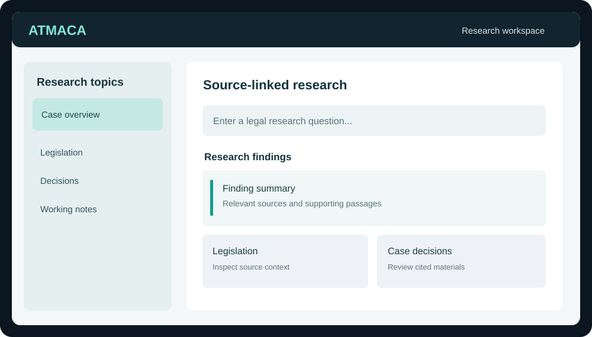
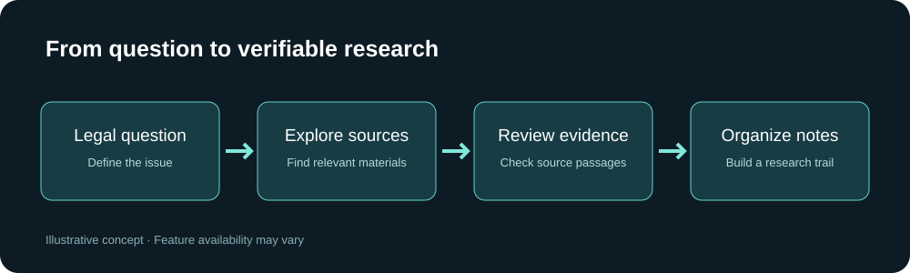

# ATMACA

### Legal research, with the evidence in view.

**An AI-powered legal research workspace designed for clearer, source-linked workflows.**

**[Launch ATMACA](https://atmaca-chat.vercel.app)**

---

## The idea

Legal research involves more than finding an answer. Legal professionals need to examine the underlying authorities, understand context, and organize findings into a defensible research trail.

**ATMACA** is being built around that workflow: bringing legal questions, relevant legislation, decisions, source passages, and notes into a more coherent research experience.

## Product highlights

| Research with context | Trace the sources |
| --- | --- |
| Explore relevant legal materials in one workspace. | Follow research findings back to their supporting materials. |
| **Organize your work** | **Stay in control** |
| Keep research notes and useful references together. | Review and verify sources rather than relying on unsupported AI output. |

## Product experience

The images below are **design concepts**, not a claim that every depicted feature is available in the live application.

  
   Illustrative workspace concept

 

  
   Illustrative source-linked workflow

## Who we're building for

- Lawyers researching legislation, decisions, and legal arguments
- Legal teams organizing source materials and working notes
- Professionals who need transparent, verifiable AI-assisted research

## Project status

ATMACA is under active development. This repository is the **public-facing product showcase**, not the application's source repository.

**No proprietary application code is published here.** Future public releases, integrations, or open-source components will be added deliberately after review.

## Explore and connect

- **Product:** [atmaca-chat.vercel.app](https://atmaca-chat.vercel.app)
- **Founder:** [Eren Senegör](https://github.com/eren1907sngr-blip)
- **Updates:** Follow this repository for public project updates.

---

**ATMACA — Research with clarity. Verify with confidence.**

ATMACA is a research aid, not a substitute for independent professional legal judgment. Verify legal authorities and conclusions before relying on them.

